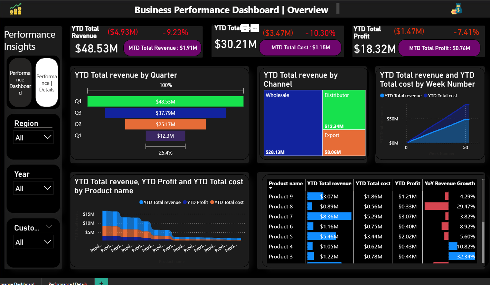
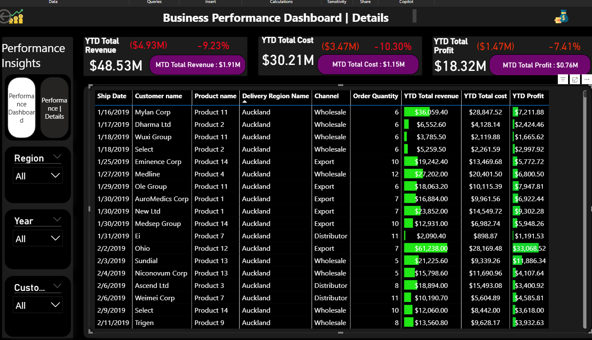

# Business Performance Dashboard — Power BI

A portfolio dashboard for monitoring sales, revenue, costs and profitability across products, customers, regions and channels.

## Dashboard preview

### Summary



### Details



## Business questions

- How are revenue, costs and profit changing over time?
- Which products, customers, regions and channels contribute most to performance?
- Where should management investigate adverse variances?

## Approach

The two-page report combines KPI cards, time intelligence, interactive charts, slicers and detailed tables. The documented star schema consists of FactSales, DimProducts, DimCustomer, DimRegion and Date_Table.

The report uses DAX measures for year-to-date and month-to-date reporting, year-over-year comparisons and conditional formatting. Example:

```dax
YTD Total Revenue =
TOTALYTD(SUM(FactSales[Revenue]), Date_Table[Date])
```

## Using the report for decisions

Use period comparisons to identify adverse trends, then filter by product, region or channel to investigate their contribution. Review revenue alongside costs and profit rather than relying on sales volume alone. These are suggested analytical workflows, not independently validated business findings.

## Open the project

1. Download [the Power BI report](Business_performance_dashboard.pbix).
2. Open it in Power BI Desktop.
3. Explore the summary and details pages using the available slicers.
4. If refreshing requires the original data source, reconnect the appropriate dataset.

The original dataset source and refresh requirements are not documented here. The screenshots provide a preview without requiring Power BI Desktop.

**Tools:** Power BI Desktop, DAX, star schema modelling.

**Author:** Ian Mutuma · [LinkedIn](https://linkedin.com/in/ian-mutuma-3639bb280)
